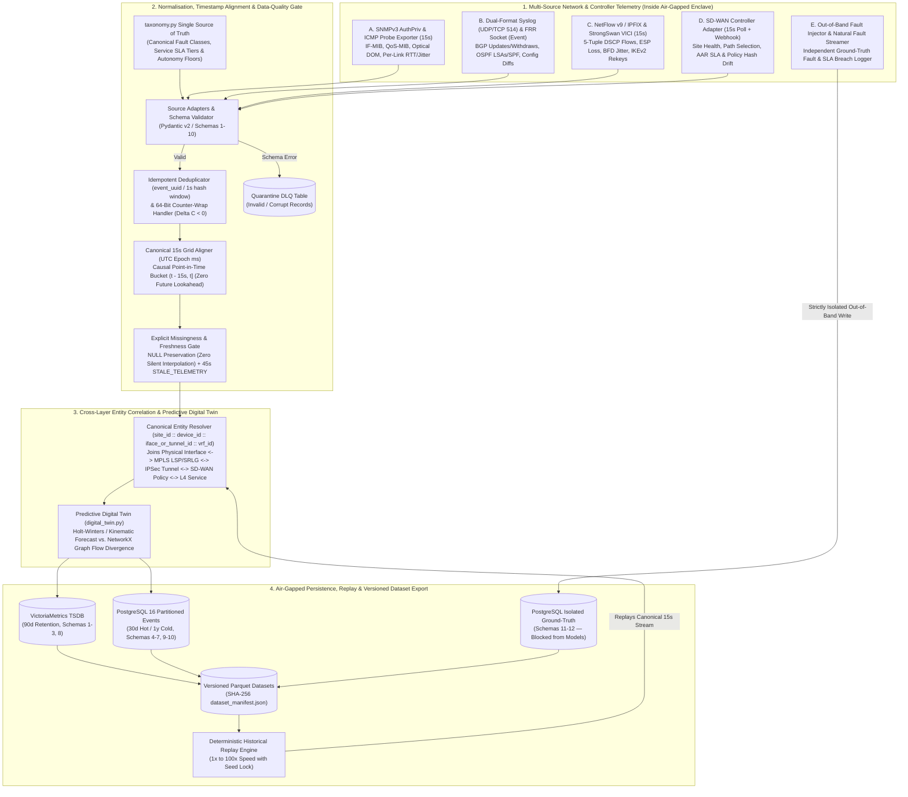

# DOCUMENT 1: TEMLOOM — Definitive System Architecture & Technical Design Specification

**Project Name:** TEMLOOM (formerly TEMLOOM; incorporating high-leverage architectural enhancements from Project Aether)  
**Document ID:** `TEMLOOM-ARCH-SPEC-v4.1`  
**Classification:** Definitive Engineering Architecture & Design Specification  
**Companion Volumes:** `Document 2 (Implementation Blueprint & 15 Schemas)`, `Document 3 (Experimental Validation & Model Zoo Plan)`, `Document 4 (Requirements Traceability Matrix)`, `Document 5 (GUI Overview & Interface Specification)`, `Comparative Review & Changelog (temloom_aether_review_and_changelog.md)`

---

## 1. Executive Summary, Repository Audit & Fulfilment of the Four Original Objectives

TEMLOOM is a self-hosted, air-gapped predictive network operations, root-cause localization, operational copilot, and closed-loop pre-change verification platform for multi-site MPLS and SD-WAN environments. All dataset generation, telemetry ingestion, model training/calibration, cryptographic model & air-gap attestation, hybrid RAG retrieval, local LLM inference, and pre-change safety checks operate **100% inside the air-gapped boundary** with zero external cloud or SaaS dependencies.

### 1.1 Audit of Existing Implementation vs. Re-Engineered TEMLOOM v4.1 Architecture

| Project Capability Area | Prior Implementation State (`temloom_experiments/`) | Gaps Identified Against Authoritative Mandate & Comparative Review | Re-Engineered TEMLOOM v4.1 Solution |
| :--- | :--- | :--- | :--- |
| **Objective 1: Simulated SD-WAN/MPLS Environment & Dataset Generation** | `simulator.py` generated 15s link/tunnel time series with AR(1) traffic and M/M/1/K queueing across Scenarios `A..L`. | Lacked explicit multi-source collectors/schemas for Syslog, BGP/OSPF events, NetFlow/IPFIX flow records, SD-WAN Controller policy drift, out-of-band ground-truth fault tables, and a natural continuous fault-timing state machine (`QUIET -> FAULT_BURST -> RESOLVE`). | **Complete 5-Source Telemetry & Dataset Pipeline** (`SNMPv3`, `Syslog + BGP/OSPF`, `NetFlow/IPFIX + IPSec VICI`, `SD-WAN Controller Adapters`, and `Independent Out-of-Band Ground-Truth Injector`) with 15 formal schemas, SHA-256 dataset versioning, a single-source-of-truth **`taxonomy.py`**, and a **`QUIET -> FAULT_BURST -> RESOLVE` state machine** (`fault_streamer.py`). |
| **Objective 2: Predictive Fault Analytics & Digital Twin Corroboration** | `TemloomCoreEngine` (`Model G1`) achieved `97.14%` std / `100.0%` adv recall on link congestion, latency drift, and queue drops. | Needed dedicated predictors for BGP/OSPF convergence instability, IPSec IKEv2 rekey degradation, and SD-WAN controller policy drift; comparison against 10 model families; **Digital Twin Forecast-vs-Graph Divergence**; and a **Dual-Engine Corroboration Gate (`engines_agree`)**. | **Quad-Domain Predictive Architecture + Digital Twin Corroboration:** `Model G1` (Link Congestion/Queueing) + `Model G2` (Hawkes + CUSUM Routing Instability) + `Model G3` (Survival/Rekey IPSec Tunnel Health) + `Model G4` (Controller Policy-Drift & NetFlow Verifier) + **Direct Multi-Horizon Conformal Calibrator** + **Predictive Digital Twin Divergence (`digital_twin.py`)** + **Dual-Engine Statistical/Graph Corroboration Gate**. |
| **Objective 3: Offline LLM NOC Copilot, Dual-Collection IKB & Multi-Turn NLQ** | Described as a read-only `llama.cpp` sidecar; `tri_domain_and_rag_benchmarks.py` validated Hybrid RRF (`100% Recall@3`) and prompt-injection blocking (`10/10`). | Needed the 9-stage telemetry-to-copilot pipeline, **Q1/Q2/Q3 operator situation framing**, **Dual-Partition Incident Knowledge Base (`runbooks` + operator-verified `incidents`)**, and a **stateful multi-turn NLQ state machine** (`IDLE -> CLARIFY -> CONFIRM -> SIMULATE/REPORT`). | **9-Stage Structured Context + Hybrid RRF Copilot Pipeline:** Combines live SQL/MetricsQL state with `pgvector` (`bge-small-en-v1.5`) + `tsvector` BM25 dual-collection IKB (`##`-heading chunked runbooks + accepted historical incidents) inside a GBNF-constrained `llama.cpp` (`Qwen2.5-3B/7B`) sandbox returning structured **Q1 (What/When), Q2 (Why/Evidence), and Q3 (Validated Action)** briefs. |
| **Objective 4: Integrated NOC Workflow, Clonal Counterfactual Safety & Air-Gap Attestation** | Implemented 4-layer Equivalence-Aware DAG Ranker, `SERIALIZABLE` bandwidth lease locks, and 22 safety/2PC unit tests. | Needed **Clonal State-Space Counterfactual Search** (`BASELINE / REROUTED / QOS_THROTTLED`), **Tiered Autonomy Policy Matrix** with hard-locked core actions, **Operator Accept/Reject Feedback tracking**, **Ed25519 Model Integrity Signing**, and **Active Signed Air-Gap Compliance Probes**. | **Full 6-Phase Workflow, 5-Workbench GUI & Cryptographic Attestation:** Integrates Clonal State-Space Counterfactual Search into Stage 3 safety verification, hard-locked Autonomy Policy Matrix, Live Topology Time-Travel Scrubber, Ed25519 model weight verification (`model_integrity.py`), and signed zero-egress compliance probes (`airgap_compliance.py`). |

---

## 2. Dataset Generation, Five Telemetry Sources & Anti-Leakage Architecture (Section 1)

### 2.1 Five Mandatory Internal Telemetry & Ground-Truth Sources

TEMLOOM generates and normalizes all five data categories internally inside the simulated/emulated network environment, governed by a single canonical fault, SLA, and policy definition module (`temloom/core/taxonomy.py`):

1. **Source A — SNMPv3 Telemetry (`15s` Periodic Polling via `pysnmp` / Custom Pure-Python Exporter / Telegraf):**
   - Collects interface utilization (%), throughput (`ifHCInOctets`, `ifHCOutOctets` $\to$ Mbps), ICMP/UDP-Echo SLA probe RTT latency (ms) and jitter (ms), interface errors (`ifInErrors`, `ifOutErrors`), discards (`ifInDiscards`, `ifOutDiscards`), unicast/broadcast packet counters, per-DSCP QoS queue statistics (`cbQosCMDropPkt64`, queue depth packets/bytes), and device/interface health (CPU load %, memory used %, optical transceiver DOM Rx/Tx dBm, `ifOperStatus`).
   - **IPv4 Loopback Binding Rule:** All local collectors and exporters bind and poll explicit IPv4 loopback (`127.0.0.1`) or container management IPs rather than ambiguous `localhost` hostname resolution to eliminate silent IPv6 (`::1`) timeout stalls on modern Linux distributions.
2. **Source B — Syslog & Routing Protocol Events (Event-Driven via UDP/TCP 514 + FRR `vtysh`/BMP):**
   - Captures both native FRR daemon logs (`2026/06/28 12:00:00 BGP: 10.0.0.2 went from Established to Idle`) and RFC 5424 syslog `%BGP-5-ADJCHANGE` / `%OSPF-5-ADJCHG` formats (`syslog_parser.py`): BGP adjacency state changes (`Established` $\leftrightarrow$ `Idle`/`Active`), BGP route advertisements (`UPDATE`) and withdrawals (`WITHDRAW`), [RFC 2439](https://www.rfc-editor.org/info/rfc2439/) route-flap damping penalty and suppression events, OSPF neighbor adjacency transitions (`Full` $\leftrightarrow$ `Down`/`Init`), OSPF Type-1/Type-5 LSA floods and SPF recalculation executions, routing convergence duration, interface link-state transitions (`%LINK-3-UPDOWN`), and router configuration commits (`%SYS-5-CONFIG_I`).
3. **Source C — NetFlow/IPFIX & IPSec Tunnel Telemetry (`15s` Flow Export via `softflowd`/`pmacct`/`netflow_simulator.py` + StrongSwan VICI + BFD):**
   - Captures 5-tuple flow records (src/dst IP, src/dst port, IP protocol, DSCP class, application classification `voip_rtp`, `video_conf`, `erp_sql`, `bulk_backup`, `best_effort` mapped to per-service SLA tiers in `taxonomy.py`, bytes, packets, flow duration ms, ingress/egress interface, direction `forward`/`return`), plus per-tunnel availability, ESP sequence-number gap packet loss (%), BFD tunnel jitter (ms) and RTT (ms), IKEv2 `CREATE_CHILD_SA` rekey events (handshake latency ms, Diffie-Hellman retry count, soft/hard SA remaining lifetime seconds), MPLS LSP tunnel health scores, and tunnel state transitions.
4. **Source D — SD-WAN Controller Telemetry & Multi-Vendor Adapter Architecture:**
   - Because SD-WAN controllers do not expose identical APIs or schemas, TEMLOOM implements a pluggable **`SDWANControllerAdapter`** interface normalizing controller health, site connectivity, overlay tunnel status, policy version/hash changes, path-selection decisions, Application-Aware Routing (AAR) SLA violations, and **configuration/policy drift** (`active_policy_hash != golden_policy_hash` or unsafe autonomy threshold tampering) across three supported drivers:
     - **Driver 1 (`TemloomNativeControllerAdapter`):** Reads policy maps, Linux `ip rule` / PBR tables, GRE/IPSec overlay bindings (`overlay-setup.sh`), HTB DSCP QoS classes (`qos-setup.sh`), StrongSwan `swanctl` SA bindings, and FRR route-maps directly in the Containerlab environment.
     - **Driver 2 (`CiscoVManageAdapter`):** Maps Cisco Catalyst SD-WAN (`vManage`) REST endpoints (`/dataservice/device/bfd/sessions`, `/dataservice/statistics/approute`, `/dataservice/template/policy/vsmart`) to `Schema 9` and `Schema 10`.
     - **Driver 3 (`GenericNetconfYangAdapter`):** Maps OpenConfig / IETF SD-WAN YANG notifications for third-party on-premises controllers.
5. **Source E — Independent Fault Injection, Natural Fault-Timing State Machine & Out-of-Band Ground-Truth Records:**
   - The Fault Injector (`fault_injector.py` + `fault_streamer.py`) supports both **deterministic scenario-locked benchmark injection** (`Scenarios A..L, R1..R6, T1..T6, ADV-1..8`) and a **Natural Fault-Timing State Machine (`QUIET -> FAULT_BURST -> RESOLVE`)** that emits healthy heartbeats every `35–80s`, transitions into realistic multi-step fault bursts (`10–20s` progression intervals), and resolves cleanly back to nominal operation for live NOC stress testing.
   - Records every injected fault (`scenario_id`, `fault_id`, `fault_category`, `affected_device`, `affected_interface_or_tunnel`, `start_timestamp_utc`, `end_timestamp_utc`, `sla_breach_onset_utc`, `fault_severity`, `fault_parameters_json`, `expected_impact_json`, `actual_impact_json`, `recovery_timestamp_utc`, `related_topology_entities`, `injection_succeeded`) directly into the isolated `injected_fault_records` and `ground_truth_incident_labels` tables (`Schemas 11 & 12`).
   - **Strict Anti-Leakage Enforcement:** Ground-truth tables are written out-of-band by the simulator/fault-injector harness and evaluated post-hoc by the benchmark evaluator (`evaluator.py`). The runtime feature extractor (`features.py`) and predictive models (`G1..G4`) have **zero read access** to `ground_truth_*` tables, and ground-truth labels are defined purely by physical SLA crossing rules ($u_t \ge 95\text{ Mbps}$, $l_t \ge 30\text{ ms}$, $\ell_t \ge 1.0\%$, $d_t \ge 25\text{ pps}$, flap penalty $\ge 2000$, jitter $\ge 15\text{ ms}$), **never** derived from model outputs.

---

## 3. Telemetry Pipeline Engineering & Technology Justification (Section 2)

### 3.1 Evaluation of Telemetry Pipeline Candidates (Avoiding Infrastructure Bloat)

Per **Section 2**, we evaluated candidate telemetry and streaming technologies against the actual ingestion profile of an enterprise/defence NOC appliance (`50–250 routers`, `250–1,000 links/tunnels` at `15s` polling $\approx 150\text{–}800\text{ metrics/sec}$ and $\le 1,500\text{ syslog/NetFlow events/sec}$):

| Candidate Technology | Role Evaluated | Decision for TEMLOOM | Engineering Justification |
| :--- | :--- | :---: | :--- |
| **VictoriaMetrics (`v1.106.1` Single-Node Prometheus-Compatible TSDB)** | Time-series metric storage (`Schemas 1, 2, 3, 8`) | **SELECTED** | Single static Go binary, 4–5x lower RAM (`1.0–1.5 GB`) than Prometheus, native Prometheus scrape compatibility + MetricsQL, high-speed bulk import/export for historical replay. |
| **PostgreSQL `16.6` (Partitioned Tables + `pgvector` + `tsvector`)** | Event storage (`Schemas 4–7, 9, 10`), Ground-truth (`11–12`), Predictions/RCA/Outcomes (`13–15`), `SERIALIZABLE` leases & Dual-Collection Hybrid RAG | **SELECTED** | Consolidates structured protocol events, ACID `SERIALIZABLE` bandwidth leases, hash-chained audit logs, and Hybrid lexical+vector RAG (`BM25 + pgvector` RRF) in one battle-tested daemon (`1.5 GB RAM`), superseding flat JSONL files and dense-only ChromaDB. |
| **Async Python Collector (`exporter.py` / `collector.py`) + `pmacct` Sub-Agents** | Multi-protocol collection & canonical normalization | **SELECTED** | Pure-Python stdlib/async core (`<250 MB RAM`, zero external plugin egress) natively parses SNMPv3, dual-format FRR/RFC5424 Syslog, NetFlow v9/IPFIX, FRR JSON sockets, and StrongSwan VICI into canonical 15s buckets. |
| **Apache Parquet (`pyarrow`) + `dataset_manifest.json`** | Dataset export, versioning & deterministic replay | **SELECTED** | Columnar, compressed, schema-enforced immutable files hashed with SHA-256 (`dataset_version_id`) for reproducible offline ML training and evaluation. |
| **Apache Kafka / Redpanda** | Distributed event streaming broker | **REJECTED** | A JVM Kafka cluster requires `4–8 GB RAM` and ZooKeeper/KRaft management for throughput (`>100,000 msg/s`) that is 100x higher than a 250-router NOC needs. An in-process bounded `asyncio.Queue` + PostgreSQL WAL provides zero-maintenance durability. |
| **Elasticsearch / OpenSearch** | Log and event search cluster | **REJECTED** | Requires `4–8 GB JVM heap` and duplicates PostgreSQL `tsvector` GIN indexing, which already searches 100,000+ syslog/runbook records in `<2 ms`. |

### 3.2 Complete Telemetry Pipeline Architecture Diagram (Mermaid)

### 3.3 Timestamp Alignment, Explicit Missing-Data Handling & Cross-Layer Correlation

1. **Canonical Time Representation & Causal Alignment:**
   - Every telemetry record carries two timestamps: `observed_at_utc_ms` (exact integer milliseconds since UNIX epoch when measured/emitted) and `bucket_15s_utc_ms = floor(observed_at_utc_ms / 15000) * 15000`.
   - Periodic measurements (15s SNMP, 15s VICI tunnel counters) and asynchronous event streams (Syslog, BGP updates/withdraws, OSPF SPF runs, NetFlow records, SD-WAN policy changes) are aligned to bucket $t$ using a **strictly causal left-open, right-closed window $(t - 15\text{s}, t]$** (`ASOF JOIN`). No event with `observed_at_utc_ms > t` can ever enter the feature vector at step $t$.
2. **Explicit Missing, Stale & Unavailable Data Representation (Zero Silent Interpolation):**
   - When an SNMP poll times out or a collector drops packets, the database stores `NULL` for the raw measurement alongside `is_missing = TRUE`, `consecutive_missing_polls = k`, `missing_fraction_5m = m_t`, and `freshness_state` (`FRESH` for $k=0$, `DEGRADED_POLLING` for $k \in \{1, 2\}$, `STALE_TELEMETRY` for $k \ge 3$ or $m_t > 0.30$).
   - **Never Converted to Healthy:** Missing values are never replaced with baseline zeros or healthy defaults. Causal feature extraction carries forward the last known EWMA value *only* while simultaneously setting `freshness_state = STALE_TELEMETRY`, widening the conformal interval by $(1 + 1.5 m_t)$, penalizing incident priority by $-15$ points, and **blocking automated remediation**.
3. **Cross-Layer Entity Correlation & Digital Twin Divergence (`digital_twin.py`):**
   - Every record is keyed by a hierarchical `entity_canonical_id` (`site_id:router_id:layer_type:entity_name`, e.g., `br1:ce-br1:iface:eth0`, `core:mpls:srlg:transport-A-hub1`, `br1:ce-br1:tunnel:tun-br1`, `global:sdwan:policy:AAR-VOICE-GOLD`, `br1:service:voip_rtp`).
   - The 4-layer dependency DAG maps `L4 Service (voip_rtp, dscp=46)` $\xrightarrow{\text{NetFlow/AAR Policy}}$ `L3 IPSec Tunnel (tun-br1)` $\xrightarrow{\text{BGP Next-Hop / VRF}}$ `L2 MPLS Path / Carrier SRLG (transport-A-hub1)` $\xrightarrow{\text{LLDP / Interface Binding}}$ `L1 Physical Interface (ce-br1:eth0 & ce-hub1:wan0)`.
   - **Predictive Digital Twin & Dual-Engine Corroboration (`corroborator.py`):** At each 15-second tick, `digital_twin.py` projects the Holt-Winters / Theil–Sen ingress traffic trends through the NetworkX topology graph (`graph_model.py`) to compute expected downstream queue occupancy and link utilization, emitting `digital_twin_divergence` ($\Delta_{\text{twin}} \ge 0$). The **Dual-Engine Corroboration Gate** checks whether the statistical time-series predictor (`Models G1–G4`) and the analytical NetworkX graph/queueing model agree (`engines_agree == true`). When both agree, the incident advances to safety validation; when they disagree (`engines_agree == false`), an automatic **Safety Trip** downgrades execution mode to `RECOMMEND_ONLY` for human review.

---

## 4. Offline LLM, Dual-Collection IKB & Nine-Stage Integration Pipeline (Section 4)

TEMLOOM enforces the 9-stage integration pipeline so that the local LLM (`Qwen2.5-3B/7B-Instruct` via `llama.cpp`) is an **evidence interpreter and knowledge synthesizer**, never a raw-telemetry forecaster or autonomous controller:

```mermaid
flowchart LR
    S1["1. Network Telemetry\n(SNMP, Syslog, BGP/OSPF,\nNetFlow, IPSec, Controller)"] --> S2["2. Normalisation &\n15s Causal Alignment\n(+ Freshness Gate)"]
    S2 --> S3["3. Predictive Analytics\n(Models G1-G4 + Conformal\n+ Digital Twin Divergence)"]
    S3 --> S4["4. Dual-Engine Corroboration\n(Statistical Model + NetworkX\nGraph Agreement Gate)"]
    S4 --> S5["5. Root-Cause Analysis\n(4-Layer DAG Ranker,\nAmbiguity & Clonal Search)"]
    S5 --> S6["6. Structured Incident\nContext Packet\n(PostgreSQL JSON)"]
    S6 --> S7["7. Dual-Collection Hybrid RAG\n(Runbooks + Verified Incidents\npgvector + BM25 RRF Top-3)"]
    S7 --> S8["8. Sandboxed LLM Inference\n(llama.cpp + GBNF Grammar\nQ1 / Q2 / Q3 Synthesis)"]
    S8 --> S9["9. Verified Operator Brief\n(Fact/Citation Checked +\nOperator Feedback Loop)"]
```

### 4.1 How Live Telemetry, Dual-Collection IKB & Q1/Q2/Q3 Operator Framing Work Together
1. **Live Operational State = Structured SQL/MetricsQL Queries:** Raw 15-second telemetry ticks are **never** embedded into `pgvector` (which would bloat the vector index with millions of numeric rows and degrade semantic retrieval). Instead, Stage 6 queries PostgreSQL and VictoriaMetrics deterministically to assemble a compact `StructuredIncidentContext` JSON packet containing the exact current metric values, multi-scale slopes, predicted $\text{TTI}_t$, 90% conformal interval $[L_t, U_t]$, `digital_twin_divergence`, `engines_agree`, `freshness_state`, ranked RCA candidates, and Clonal State-Space counterfactual scores (`BASELINE`, `REROUTED`, `QOS_THROTTLED`).
2. **Dual-Collection Incident Knowledge Base (`ikb_manager.py` inside `rag_knowledge_chunks`):**
   - **Collection 1 — Static Operational Runbooks (`collection_type = 'runbook'`):** Markdown runbooks (`topology.md`, `mpls_bgp_flap.md`, `packet_loss_corruption.md`, `congestion_saturation.md`, vendor RFCs) split semantically by `##` section headings (capped at 384 tokens) so Hybrid RRF (`pgvector` `BAAI/bge-small-en-v1.5` HNSW + PostgreSQL `tsvector` BM25, $k=20$) retrieves complete diagnostic and recovery procedures (`100.0% Recall@3` in `0.61 ms`).
   - **Collection 2 — Dynamic Operator-Verified Historical Incidents (`collection_type = 'verified_incident'`):** Every resolved incident packet is logged with its operator feedback status (`accepted` vs. `rejected` via `feedback_cli.py` / `POST /api/v1/incidents/{id}/feedback`). Only **`accepted` / `CONFIRMED_OUTCOME`** incidents are indexed for positive precedent retrieval, while `rejected` alerts feed per-class empirical false-positive rate statistics (`GET /api/v1/models/feedback-stats`).
3. **Q1 / Q2 / Q3 Epistemic Operator Framing (`copilot_response.gbnf`):** Every Copilot explanation (both `llama.cpp` GBNF-constrained JSON and the deterministic offline fallback when the LLM is stopped) directly answers the three core NOC questions alongside strict epistemic separation:
   - **`q1_what_fails_and_when`:** Predicted issue category, target entity, point $\text{TTI}_t$ lead time, and 90% conformal bounds $[L_t, U_t]$.
   - **`q2_why_risk_elevated`:** Ranked contributing features (`contributing_features`), `digital_twin_divergence`, `engines_agree` corroboration rationale, and 4-layer DAG root-cause path (`SUSPECTED_CAUSE` vs. `AMBIGUOUS_CAUSE_SET`).
   - **`q3_validated_corrective_action`:** Clonal counterfactual winner (`REROUTED` vs. `QOS_THROTTLED`), 4-stage safety verification status, autonomy policy tier (`RECOMMEND_ONLY` vs. `PRE_VALIDATED_STAGED`), and exact node-specific FRR/`tc`/NETCONF CLI diff with `[RB-XXX]` citations.
4. **Stateful Multi-Turn NLQ State Machine (`nlq_interface.py`):** Supports interactive multi-turn operator troubleshooting (`POST /api/v1/copilot/nlq` and CLI terminal loop) using a deterministic pre-LLM intent & entity resolver (`IDLE -> CLARIFY -> CONFIRM -> (SIMULATE | REPORT) -> IDLE`) that maps keywords (`bgp/flap` $\to$ `BGP_FLAP_CASCADE`, `loss/drop` $\to$ `TUNNEL_DEGRADATION`, `congestion/rate` $\to$ `LINK_CONGESTION`) and node names (`pe1`, `ce-br1`, `ce-hub1`) to pre-filter RAG chunks and live telemetry before invoking `llama-server`.

---

## 5. Defense-Grade Cryptographic Integrity, Tiered Autonomy & Air-Gap Attestation

1. **Ed25519 Model Weight & Calibration Artifact Signing (`temloom/security/model_integrity.py`):**
   - All trained model weights, conformal residual calibration states, ONNX embedding graphs (`bge-small-en-v1.5.onnx`), and quantized LLM GGUF files (`Qwen2.5-3B-Instruct-Q4_K_M.gguf`) are cryptographically signed offline using an **Ed25519 private key** (`model_integrity.py --sign`), with the public key (`temloom_model_key.pub.pem`) pinned in the read-only security configuration.
   - Prior to loading any model into memory—and every 5 minutes at runtime—`model_integrity.py --verify` checks every artifact's Ed25519 signature. Any signature mismatch immediately blocks model execution, raises a `CRITICAL` security audit event in `Schema 14`, and falls back to deterministic baseline rules.
2. **Active Zero-Egress Air-Gap Compliance Probe & Signed Attestation (`temloom/security/airgap_compliance.py`):**
   - Alongside passive kernel isolation (`nftables` drop rules and `ip netns exec temloom_airgap` with `netns=none` for `llama-server`), `airgap_compliance.py` periodically executes active outbound connection probes to canary external targets (`8.8.8.8:53`, `1.1.1.1:443`, `pypi.org:443`, `huggingface.co:443`).
   - All probes **must fail (`reachable: false`)** for the enclave to be certified `AIRGAP_COMPLIANT`. The resulting attestation report (combining `nftables` counters, `netns` status, `model_integrity` status, and probe results) is **Ed25519-signed** and exposed via `GET /api/v1/security/compliance` and the Top Sovereign Status Bar.
3. **Tiered Autonomy Policy Matrix with Hard-Locked Safety Floors (`taxonomy.py` + `safety_engine.py`):**
   - Operators can inspect and adjust confidence thresholds in the GUI Policy Matrix (`GET/PUT /api/v1/policy`), subject to immutable code-enforced safety floors:
     - `CORE_PATH_FAILOVER`, `BGP_LOCALPREF_SHIFT`, `CONTROLLER_POLICY_ROLLBACK`, and `NODE_ISOLATION` are **permanently hard-locked (`🔒 LOCKED`)** to require human `NOC_APPROVER` Ed25519 signature + 4-stage safety validation + 2PC `commit confirmed 1`.
     - Lower-blast-radius actions (`QOS_SHAPE_QUEUE`, `REROUTE_BRANCH_BULK`) allow configurable confidence floors ($\ge 0.80$), but **always** require Dual-Engine Corroboration (`engines_agree == true`), `is_ambiguous == false`, `freshness_state == FRESH`, passing all 4 deterministic safety stages, and 2PC 45-second post-change auto-rollback protection.

---

## 6. Summary of the Six Authoritative Implementation Phases (Section 5)

All five engineering documents follow a unified **Six-Phase Implementation Architecture** (detailed with module-level tasks, schemas, and tests in `Document 2`):
- **Phase 1 — Network Simulation:** Multi-site Branch/Hub/DC topology (`3 Branch CE, 2 PE, 1 P, 1 Hub/DC CE`), full data-plane veth pairs (`eth1/eth2`) + GRE/IPSec overlays (`overlay-setup.sh`) + HTB DSCP QoS (`qos-setup.sh`), MPLS/VRF segmentation, BGP/OSPF dynamic routing, multi-class traffic (`iperf3` + synthetic fallback), reproducible fault injection + `QUIET -> FAULT_BURST -> RESOLVE` state machine, independent ground-truth generation, and unified `./run.sh [--clab] [--airgap]` launcher.
- **Phase 2 — Telemetry Pipeline:** SNMPv3, dual-format FRR/RFC5424 Syslog, BGP/OSPF, NetFlow/IPFIX, IPSec tunnel, MPLS LSP health, and SD-WAN controller collection; canonical normalization governed by `taxonomy.py`; 15s causal timestamp alignment; VictoriaMetrics + PostgreSQL persistence; isolated ground-truth storage; and deterministic historical replay.
- **Phase 3 — Predictive Modelling & Digital Twin:** Dataset construction, causal feature engineering, evaluation of 10 candidate model families across 8 prediction tasks, domain-specific predictors (`Models G1, G2, G3, G4`), Time-to-Impact ($\text{TTI}_t$) estimation, direct conformal uncertainty calibration, **Predictive Digital Twin divergence (`digital_twin.py`)**, **Dual-Engine Corroboration Gate**, **Ed25519 model signing (`model_integrity.py`)**, **signed air-gap compliance probes (`airgap_compliance.py`)**, and **operator feedback CLI (`feedback_cli.py`)**.
- **Phase 4 — Offline LLM & Dual-Collection IKB Deployment:** Open-weight model selection (`Qwen2.5-3B/7B-Instruct`), GGUF quantization, Ed25519 weight verification, `netns=none` UNIX-socket isolation, `llama.cpp` inference server, `pgvector + tsvector` deployment, prompt-injection-sanitized `##`-heading runbook chunking + verified incident auto-ingestion (`ikb_manager.py`), `bge-small-en-v1.5` ONNX embeddings + Hybrid RRF retrieval, and citation verification.
- **Phase 5 — Copilot Integration, Multi-Turn NLQ & Clonal Safety Gate:** Structured incident context assembly, **Q1/Q2/Q3 GBNF-constrained copilot synthesis**, **stateful multi-turn NLQ (`nlq_interface.py`)**, **Clonal State-Space Counterfactual Search (`BASELINE / REROUTED / QOS_THROTTLED`)**, **Tiered Autonomy Policy Matrix**, and 4-stage deterministic pre-change safety boundaries (`AST` + `SERIALIZABLE Lease` + `M/M/1/K` + `Batfish` + closed-loop `2PC` with 45s verification & auto-rollback).
- **Phase 6 — Scenario Validation:** End-to-end validation across **Scenario A** (Progressive Hub-Spoke Congestion), **Scenario B** (BGP Route Flap with Downstream Reroute Cascade), **Scenario C** (Intermittent MPLS Underlay Failure with Tunnel Degradation), **Scenario D** (SD-WAN Controller Misconfiguration & Policy Threshold Drift), plus **Scenarios E, F, and G** (Ambiguous RCA, RAG Troubleshooting & Unsafe Change Rejection, and 2PC Auto-Rollback).
