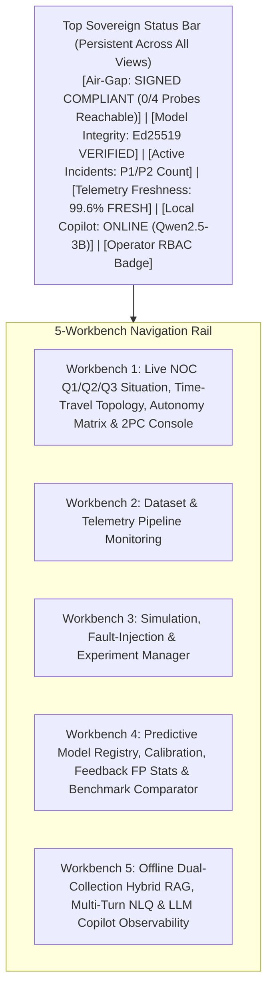

# DOCUMENT 5: TEMLOOM — GUI Overview and Interface Specification

**Project Name:** TEMLOOM

**Document ID:** `TEMLOOM-GUI-SPEC-v4.1`

**Companion Volumes:** `Document 1 (System Architecture v4.1)`, `Document 2 (Implementation Blueprint & 15 Schemas v4.1)`, `Document 3 (Experimental Validation Plan v4.1)`, `Document 4 (Requirements Traceability Matrix v4.1)`, `Comparative Review & Changelog (temloom_aether_review_and_changelog.md)`

**UI Stack:** FastAPI `0.115.5` + Jinja2 `3.1.4` + HTMX `2.0.3` + Local SVG/Canvas Charts (100% Self-Hosted, Zero External CDN Assets)

## 1. Design Philosophy & Strict Backend-Grounded UI Architecture

The TEMLOOM Operator and Engineering Console is a dark-mode (`#080D1A` / `#0F172A`), server-rendered FastAPI + Jinja2/HTMX web application served locally over TLS 1.3 (`TCP/8443`). Every panel, badge, counter, and control in the GUI maps **1-to-1 to an implemented backend table or API endpoint** (`Schemas 1–15` and `rag_knowledge_chunks` in `Document 2`).

1. **Zero LLM Dependency on the Primary Path:** If `llama-server` is stopped or unreachable, Workbenches 1, 2, 3, and 4 operate at 100% functionality (`<5 ms` render time), and the Copilot drawer in Workbench 1 automatically renders the **Deterministic Jinja2 Q1 / Q2 / Q3 Evidence Brief**.

2. **Epistemic State, Dual-Engine Corroboration & Uncertainty Visibility:** Every incident card displays its immutable `epistemic_state` badge (`OBSERVED_FACT` through `CONFIRMED_OUTCOME`), its `engines_agree` corroboration badge (`CORROBORATED` vs. `SAFETY_TRIP_DISAGREE`), its `freshness_state` badge (`FRESH`, `DEGRADED_POLLING`, or `STALE_TELEMETRY`), and its **90% Conformal Interval `[L_t, U_t]`** explicitly labeled as a metric residual bound rather than an outage probability.

3. **Cryptographic Air-Gap & Model Integrity Attestation:** The persistent Top Sovereign Status Bar displays real-time verification badges for **Signed Air-Gap Compliance (`airgap_compliance.py` — 0 Egress Probes Reachable, Ed25519 Verified)** and **Model Weight Integrity (`model_integrity.py` — Ed25519 Verified)**.

4. **Role-Based Access Control (RBAC) Enforcement:**

   * `NOC_VIEWER`: Read-only access to all 5 workbenches and the live Time-Travel Topology scrubber.

   * `NOC_OPERATOR`: Can record `Accept` / `Reject` incident feedback (`feedback_cli.py`), trigger disambiguating SNMPv3 polls, run Stage 1–3 pre-change simulations, and launch simulation replay experiments in Workbench 3.

   * `NOC_APPROVER`: Authorized to edit non-locked rows of the Autonomy Policy Matrix (`taxonomy.py`) and sign Ed25519 approval tokens to execute Stage 4 paired-router 2PC commits.

## 2. GUI Navigation & Five-Workbench Layout Architecture (Mermaid)

## 3. Detailed Specification of the Five GUI Workbenches (Section 6)

### 3.1 Workbench 1: Live NOC Q1/Q2/Q3 Situation, Topology Blast-Radius & 4-Stage 2PC Remediation Console

| UI Panel / Component | Displayed Fields & Visual Elements | Backend Data Source & API Endpoint | Operator Actions & Safeguards | 
| ----- | ----- | ----- | ----- | 
| **1A. Prioritised Incident Queue & Q1/Q2/Q3 Situation Header** | Top situation banner surfaces **Q1 (What is likely to fail next & when — TTI + 90% conformal bounds)**, **Q2 (Why risk is elevated — top-5 contributing features + `digital_twin_divergence` + `engines_agree` badge)**, and **Q3 (Validated corrective action + Clonal counterfactual score)**. Ranked queue sorted by deterministic $P_{\text{incident}} \in [0, 100]$. | `GET /api/v1/incidents?status=active` (`epistemic_incidents` + `Schema 13 & 14`) | Clicking an incident loads its multi-metric conformal fan chart, 4-layer DAG, Q1/Q2/Q3 Copilot brief, and 4-stage safety gate. | 
| **1B. Multi-Metric Conformal Fan Chart** | Interactive time-series canvas plotting observed Utilization (Mbps), RTT (ms), Queue Drops (pps), Hawkes Flap Intensity $\lambda_{\text{BGP}}$, or Tunnel Jitter (ms) from $[t-20\text{m}, t]$, plus the damped point forecast $\hat{y}_{t,h}$, `digital_twin_divergence` overlay, and shaded **90% Conformal Interval Fan** $[L_{t,h}, U_{t,h}]$ over $[t, t+15\text{m}]$. | `GET /api/v1/telemetry/{entity_id}/series` (`VictoriaMetrics` + `Schema 13`) | Toggle between `5m`, `10m`, and `15m` horizons; displays amber hatched overlay if `freshness_state == STALE_TELEMETRY`. | 
| **1C. 4-Layer Topology DAG, Clonal Counterfactual & Live Time-Travel Scrubber** | Interactive SVG graph: `L4 Services (VoIP, Video, ERP, Bulk)` $\to$ `L3 IPSec/MPLS Tunnels (lsp_health_score)` $\to$ `L2 MPLS Paths & Carrier SRLGs` $\to$ `L1 Physical Interfaces & VRFs`, plus **Clonal State-Space scores (`BASELINE` vs. `REROUTED` vs. `QOS_THROTTLED`)** and an **In-Memory Time-Travel Scrubber Slider** to replay historical topology snapshots and click **`▶ Live`** to return. | `GET /api/v1/rca/{incident_id}/dag` & `GET /api/v1/topology/snapshots` (`topology_snapshots` + `Schema 8 & 14`) | When `is_ambiguous == true` (`AMBIGUOUS_CAUSE_SET`), displays a prominent amber banner listing tied candidates and a **"Poll Hub Interface via SNMPv3 Now"** button (`POST /api/v1/rca/{incident_id}/disambiguate`). | 
| **1D. 4-Stage Pre-Change Safety, Operator Accept/Reject & 2PC Execution Log** | Displays live pass/block badges for **Stage 1 (AST Allowlist)**, **Stage 2 (`SERIALIZABLE` Lease Table showing current + reserved in-flight Mbps vs. 80% cap)**, **Stage 3 (M/M/1/K Post-Shift RTT, Clonal Winner & Batfish Reachability Diff)**, and **Stage 4 (Ed25519 Token & Paired-Router 2PC `commit confirmed 1` + 45s Watchdog Countdown)**, plus **Click-to-Copy CLI Commands**, **Captured Router Transcript (`execution_stdout_log`)**, and **Operator `Approve (Accept)` / `Reject (False Positive)` feedback buttons**. | `POST /api/v1/remediation/{incident_id}/validate`, `POST /api/v1/remediation/{incident_id}/execute-2pc`, `POST /api/v1/incidents/{incident_id}/feedback` (`Schemas 14 & 15`) | `Execute 2PC` button is physically disabled unless `epistemic_state == VALIDATED_ACTION` AND `engines_agree == true` AND `is_ambiguous == false` AND a valid `NOC_APPROVER` Ed25519 signature is provided. | 
| **1E. Tiered Autonomy Policy Matrix Drawer** | Live-editable table sourced from `taxonomy.py` showing all action classes (`QOS_SHAPE_QUEUE`, `REROUTE_BRANCH_BULK`, `CORE_PATH_FAILOVER`, `BGP_LOCALPREF_SHIFT`, `CONTROLLER_POLICY_ROLLBACK`, `NODE_ISOLATION`), minimum confidence thresholds, and execution modes. | `GET /api/v1/policy` & `PUT /api/v1/policy` (`taxonomy.py` + `Schema 10`) | Core, BGP, controller, and isolation rows are **hard-locked (`🔒 LOCKED`)** in code to `RECOMMEND_ONLY`; branch/QoS rows enforce a hard minimum safety floor ($\ge 0.80$). | 

### 3.2 Workbench 2: Dataset & Telemetry Pipeline Monitoring View (Section 6.1)

This workbench provides full engineering visibility into the 5-source telemetry pipeline (`Schemas 1–10`) and dataset storage tier:

| Required GUI Capability | Exact Metrics, Badges & Tables Displayed | Backend Source Table / Endpoint | 
| ----- | ----- | ----- | 
| **1. Telemetry Source Inventory & Collector Health** | Table listing all registered sources across **A. SNMPv3 & 10-Burst ICMP Pollers**, **B. Dual-Format Syslog/FRR Listeners (`syslog_parser.py`)**, **C. NetFlow/IPFIX (`netflow_simulator.py`) & VICI Collectors**, **D. SD-WAN Controller Adapters (`TEMLOOM_NATIVE`, `CISCO_VMANAGE`, `GENERIC_YANG`)**, and **E. Out-of-Band Fault Injector / Natural Fault Streamer**, with worker PID, explicit IPv4 socket status (`127.0.0.1` `UP`/`DEGRADED`/`DOWN`), and last poll duration (ms). | `GET /api/v1/pipeline/sources` (`collector.py` health registry) | 
| **2. Data Ingestion Rates & Event Throughput** | Real-time sparklines showing `SNMP metrics/sec`, `Syslog events/sec`, `BGP/OSPF routing events/sec`, `NetFlow flow records/sec`, and `SD-WAN controller events/sec`. | `GET /api/v1/pipeline/throughput` (VictoriaMetrics internal counters) | 
| **3. Source Freshness & Explicit Missing-Data Monitor** | Per-entity matrix showing current `freshness_state` (`FRESH` $\le 15\text{s}$, `DEGRADED_POLLING` $16\text{–}45\text{s}$, `STALE_TELEMETRY` $>45\text{s}$), `consecutive_missing_polls`, rolling 5-minute missing fraction $m_t$, and explicit `NULL` count (confirming zero silent interpolation). | `GET /api/v1/pipeline/freshness` (`Schemas 1, 2, 3, 8`) | 
| **4. Invalid Records & Quarantine Dead-Letter Queue (DLQ)** | Counter and inspectable table of malformed/rejected packets in `telemetry_quarantine_dlq` (e.g., Pydantic range violations, negative non-wrap deltas, or untrusted syslog prompt-injection attempts blocked by `sanitizer.py`). | `GET /api/v1/pipeline/quarantine-dlq` (`telemetry_quarantine_dlq`) | 
| **5. Timestamp Alignment & Counter-Wrap Audit** | Histogram of `bucket_15s_utc_ms - observed_at_utc_ms` clock/poll skew across routers (`0–15,000 ms` causal window check) + counter of 64-bit monotonic wrap clamps ($\Delta C < 0$) and 3-tick glitch clamps applied. | `GET /api/v1/pipeline/alignment-audit` (`freshness_gate.py`) | 
| **6. Storage Utilisation, Retention & Dataset Version Info** | Disk usage bars and retention status for VictoriaMetrics (`90d` retention, MB used), PostgreSQL partitioned event tables (`30d` hot / `1y` cold), and exported Parquet datasets (`dataset_version_id`, SHA-256 hash, row count, and `Export Snapshot to Parquet` button). | `GET /api/v1/datasets/versions` & `POST /api/v1/datasets/export` (`dataset_manifest.json`) | 

### 3.3 Workbench 3: Simulation, Fault-Injection & Experiment Management View (Section 6.2)

This workbench allows engineers and evaluators to configure, inject, replay, and audit controlled experiments (`Schemas 11 & 12`):

| Required GUI Capability | Exact Controls, Timelines & Tables Displayed | Backend Source Table / Endpoint | 
| ----- | ----- | ----- | 
| **1. Scenario, Natural Fault Streamer & Fault-Injection Configurator** | Selector for all 32 pre-registered scenarios (`Link A..L`, `Routing R1..R6`, `Tunnel T1..T6`, `Adversarial ADV-1..8`, `Integrated Scenarios A..G`), toggle for **Natural Fault-Timing State Machine (`QUIET -> FAULT_BURST -> RESOLVE`)**, + custom parameter sliders (ramp slope `Mbps/min`, `ef_share`, BGP flap rate, IKEv2 DH retry rate, missing poll %, policy hash drift). | `POST /api/v1/experiments/configure` (`scenarios.yaml`, `fault_injector.py`, `fault_streamer.py`) | 
| **2. Deterministic Random Seed & Experiment ID Lock** | Input field for integer `random_seed` (with preset buttons for Held-Out Test Seeds `301..310` and Adversarial Seeds `401..410`), auto-generated immutable `experiment_id` (`EXP-YYYYMMDD-SEED`), and tied `dataset_version_id` + Ed25519-signed `model_version_id`. | `POST /api/v1/experiments/start` (`Schema 11`) | 
| **3. Simulation Replay Scrubber & Speed Controller** | Interactive timeline scrubber ($t = 0.0\text{m}$ to $40.0\text{m}$ at $\Delta t = 15\text{s}$ steps) with `Play`, `Pause`, `Step +15s`, and replay speed selector (`1x Real-Time`, `10x`, `50x`, `Instant Batch`). | `POST /api/v1/experiments/{exp_id}/step` (`replay_engine.py`) | 
| **4. Dual Ground-Truth vs. Prediction Timeline** | Synchronized two-track timeline comparing **Track 1: Independent Out-of-Band Ground Truth** (`fault_injected_at`, physical `sla_breach_onset_ms`, `recovery_utc_ms` from `Schemas 11 & 12`) against **Track 2: TEMLOOM Predictions & Actions** (`PREDICTED_EVENT` onset, realized lead time $\Delta t_{\text{lead}}$, point $\text{TTI}_t$ error, and 2PC remediation timestamp). | `GET /api/v1/experiments/{exp_id}/timeline` (`Schemas 11, 12, 13, 15`) | 
| **5. Dataset Generation Status & Experiment History** | Table of all historical experiment runs showing `experiment_id`, `dataset_version_id` (`SHA-256`), scenarios executed, incident recall, FA/hr, median lead time, TTI MAE, and downloadable JSON/CSV/Parquet reproducibility bundles. | `GET /api/v1/experiments/history` (`ground_truth_incident_labels`) | 

### 3.4 Workbench 4: Predictive Model Management, Calibration, Feedback Stats & Benchmark Comparator View (Section 6.3)

This workbench provides ML and network reliability engineers with complete visibility into all predictive models (`Models G1–G4` and the 10 baseline/candidate families):

| Required GUI Capability | Exact Scorecards, Curves & Controls Displayed | Backend Source Table / Endpoint | 
| ----- | ----- | ----- | 
| **1. Production Model Inventory & Ed25519 Signature Registry** | Cards for the 4 active domain engines: **`Model G1` (Link Congestion/Queueing)**, **`Model G2` (Hawkes/CUSUM Routing Instability)**, **`Model G3` (Survival/Rekey IPSec Tunnel Health)**, and **`Model G4` (SD-WAN Controller Policy Drift)**, showing `model_version_id`, code SHA-256, **Ed25519 signature verification badge (`model_integrity.py --verify`)**, active status, and mean CPU inference latency (`0.420 ms`, `0.030 ms`, `0.063 ms`, `0.015 ms`). | `GET /api/v1/models/registry` (`prediction_outputs` + `model_integrity.py`) | 
| **2. Conformal Calibration, Bounded-Freeze & Operator Feedback FP Tracker** | Live plot of rolling empirical 10-minute coverage vs. nominal $1-\alpha = 90.0\%$ target (`89.20%` strict unpadded / `91.80%` padded), current residual buffer size $\vert{}\mathcal{R}_{40}\vert{} / 80$, current quantile half-width $q_{10\text{m}}(t)$, **Bounded Freeze TTL counter (`freeze_counter / 16 steps`)**, and **Operator Accept/Reject False-Positive Rate per fault class (`feedback_cli.py --stats`)**. | `GET /api/v1/models/calibration` & `GET /api/v1/models/feedback-stats` (`conformal_aggregator.py` + `Schema 14`) | 
| **3. 10-Model Candidate Benchmark Comparator** | Interactive comparison matrix & bar charts comparing **`TEMLOOM Multi-Domain Engine`** against **`Static Threshold (Model A)`**, **`EWMA + Theil–Sen (Model B)`**, **`Hist-GBDT (Model C)`**, **`CUSUM + Holt (Model D)`**, **`Legacy GBDT Hybrid (Model E)`**, **`Un-damped Prototype (Model F)`**, **`Prophet-Style Fourier`**, **`Recurrent Gated BiLSTM + Attention (Aether Baseline)`**, and **`Isolation Forest`** across all 8 prediction tasks (`Precision`, `Recall`, `FA/hr`, `Med Lead Time`, `TTI MAE`, `10m Coverage`, `Latency ms`). | `GET /api/v1/models/benchmarks` (`tri_domain_results.json` + `extended_model_zoo_results.json`) | 
| **4. On-Demand Training, Calibration & Evaluation Runner** | Button to re-execute the leakage-free train (`101..105`), calibration (`201..205`), held-out test (`301..310`), and adversarial (`401..410`) benchmark suite in the background and verify all acceptance gates (`GATE-01..11`). | `POST /api/v1/models/run-evaluation` (`run_all_benchmarks.py`) | 

### 3.5 Workbench 5: Offline Dual-Collection Hybrid RAG, Multi-Turn NLQ & Sandboxed LLM Copilot Observability View (Section 6.4)

This workbench provides full transparency into the local AI infrastructure, dual-collection IKB retrieval pipeline, multi-turn NLQ console, prompt-injection sanitizer, and signed air-gap attestation:

| Required GUI Capability | Exact Telemetry, Logs & Controls Displayed | Backend Source Table / Endpoint | 
| ----- | ----- | ----- | 
| **1. Local LLM Runtime & Signed Air-Gap Compliance Status** | Status card showing `llama-server` health (`ONLINE` / `DISABLED_FALLBACK_ACTIVE`), loaded GGUF filename (`Qwen2.5-3B-Instruct-Q4_K_M.gguf`), Ed25519-verified SHA-256 weight hash, memory RSS (`2.1 GB`), p50/p99 token generation latency, kernel isolation badges (`netns=none VERIFIED`, `Socket: /run/temloom/llm.sock`, `DB Role: temloom_copilot_ro SELECT-ONLY`), and **Signed Air-Gap Compliance Probe card (`0/4 External Canary Probes Reachable — Ed25519 Signed`)**. | `GET /api/v1/copilot/status` & `GET /api/v1/security/compliance` (`llm_client.py` + `airgap_compliance.py`) | 
| **2. Dual-Collection IKB Inventory & Ingestion Monitor (`runbooks` + `verified_incidents`)** | Breakdown of indexed chunks in `rag_knowledge_chunks` across **Collection 1: Static Runbooks (`##`-heading chunked markdown, configs, policies, vendor RFCs)** and **Collection 2: Dynamic Operator-Verified Incidents (`accepted` historical ACPs synced by `ikb_manager.py`)**, embedding model status (`BAAI/bge-small-en-v1.5` ONNX, 384-dim, Ed25519 verified), last ingestion timestamp, and **"Re-Index Local Knowledge Directory"** button. | `GET /api/v1/copilot/rag-stats` & `POST /api/v1/copilot/reindex` (`ikb_manager.py` + `rag_indexer.py`) | 
| **3. Prompt-Injection Sanitizer & Ingestion Error Log** | Security audit table logging every stripped instruction-override string, XML tag escape (`</untrusted_document_chunk>`), ChatML control-token injection (`im_start` / `im_end`), and malformed telemetry record blocked by `sanitizer.py` before indexing or prompting. | `GET /api/v1/copilot/sanitizer-audit` (`sanitizer.py` + `audit_log_chain`) | 
| **4. Multi-Turn NLQ Console & Live Retrieval Attribution Inspector** | Interactive multi-turn **"Ask TEMLOOM"** chat console (`POST /api/v1/copilot/nlq` + `/reset`) showing resolved intent state (`IDLE -> CLARIFY -> CONFIRM -> SIMULATE/REPORT`), pre-filtered node/fault tags, exact **BM25 rank**, **pgvector cosine similarity rank**, and **Filtered RRF fused score** of the Top-3 retrieved chunks, raw `<untrusted_document_chunk>` text, GBNF validation status (`VALID_JSON`), and **Post-Generation Fact & Citation Verifier badge** (`100% Citations & Metrics Verified Against PostgreSQL`). | `POST /api/v1/copilot/nlq` & `GET /api/v1/copilot/history` (`nlq_interface.py`, `rag_retriever.py`, `llm_client.py`) | 
